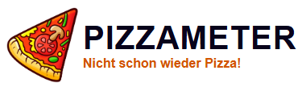
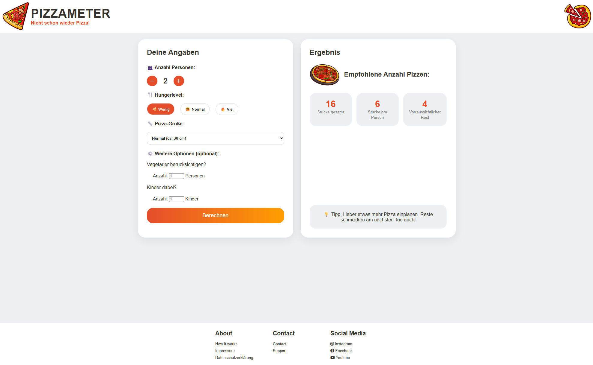

# 🍕 Pizzameter

The website uses various factors to calculate the optimal number of pizzas for a group.  
In addition to the calculation, the website provides statistics, tips, and predictions,  
so that your next pizza night won't leave anyone hungry or result in too many leftovers.

## 🛠 Skills

Javascript, HTML, CSS

## 🕑 Current status

## ✔️ ToDo´s

- ~~erstes grobes Grundgerüst erstellen~~
- ~~Icon im Tab anzeigen~~
- ~~Header fertigstellen~~
  > ~~Logo, Name und Slogan nach links, rechts Pizzasymbol einfügen~~
- ~~Footer fertigstellen~~
- ~~Berechnung der Pizzastücke hinzufügen anhand der Personenanzahl, Hungerlevel und Pizzagröße~~
- ~~Ergebnis der Berechnung anzeigen lassen~~
- ~~beim Tipp immer wechselne Tipps anzeigen lassen~~
  > ~~zum Beispiel 7 Tipps, die täglich wechseln~~
  > ~~z. B wie man eine Pizza am nächsten Tag perfekt erwärmt~~
- ~~Ergebnis rechts neben dem Pizzasymbol (statt darunter) anzeigen lassen~~
- Weitere Optionen hinzufügen und für die Berechnung berücksichtigen
  > Vegetarisch? kinder dabei?
- Kostenrechner hinzufügen

  > Eingabefelder hinzufügen für "Preis pro Pizza", "Liefergebühren" und "Trinkgeld"

  > Ausgabefeld mit Preis pro Person

- @media Abfragen in CSS (für Responsives Design) verbessern
- Eingaben validieren und Fehler abfangen (Gültige Wertebereiche für Eingabefelder festlegen)
- Zurücksetzen-funktion hinzufügen
  > Ein Button der den Wert aller Felder auf den Standardwert zurücksetzt
- Unit-tests hinzufügen mit Vitest
- E2E tests hinzufügen mit Playwright
- Dokumentation schreiben

## 📃 License

[MIT](https://choosealicense.com/licenses/mit/)
